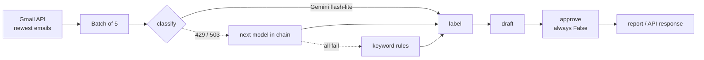

# Email Triage Agent


An LLM agent that reads my Gmail, classifies each email, picks a label, and drafts a reply when one is needed. It **never sends anything**: a human approval gate sits at the end of every run.

Built with **LangGraph**, **Gemini** (`google-genai`), the **Gmail API**, **FastAPI**, **pytest**, and **GitHub Actions**.

## How it works



| Node | What it does |
|---|---|
| `classify` | One of `job`, `bill`, `promo`, `spam`, `needs_reply` |
| `label` | Maps the category to a Gmail label name |
| `draft` | Writes a reply only for `job` / `needs_reply` from a real person |
| `approve` | Always returns `False`, so nothing is sent without a human |

## Reliability and guardrails

- **Model fallback chain:** `gemini-3.1-flash-lite` → `gemini-3.8-flash` → `gemini-3.7-flash` → keyword rules. A quota error (429) or overload (503) moves to the next model; the agent never crashes.
- **Batching:** 5 emails per LLM call with JSON-mode output and length validation. That's 5x more emails per free-tier quota, and about 2 seconds per batch.
- **Temperature 0** for consistent classifications.
- **Safe defaults:** an unknown model answer becomes `needs_reply`, so a human sees it.
- **No drafts to automated senders** (`noreply`, `mailer-daemon`, and similar).
- **Logging:** every call prints the model used, latency, and the reason for any fallback.
- **Secrets** live in `.env` (gitignored). Real emails used for evals are gitignored too.

## Evals

`app/save_eval_set.py` freezes a snapshot of real emails, and I labeled each one with the correct answer (ground truth). `app/run_eval.py` scores the classifier against it using the same code path as production.

| Run | Change | Score |
|---|---|---|
| Baseline | Category names only | **6/10 (60%)** |
| v2 | Added category definitions (security alerts are `needs_reply`, spam is scams only) | **10/10 (100%)** |

The failures were a prompt problem, not a model problem: the categories were never defined, so the model guessed that login alerts were spam. Next step: a larger, held-out eval set with job and personal emails to guard against overfitting.

## API

```bash
uvicorn app.api:app --port 8000
```

- `GET /health` returns `{"status": "ok"}`
- `POST /triage` takes `{"sender": "...", "subject": "...", "body": "..."}` and returns the category, label, draft, and `approved: false`. A missing field returns 422.

Interactive docs at `http://localhost:8000/docs`.

## Run it

```bash
python -m venv .venv
.venv\Scripts\activate            # Windows
pip install -r requirements.txt
# add GEMINI_API_KEY=... to .env, and Gmail OAuth credentials.json
python -m app.run_real            # triage the 10 newest emails
python -m app.run_eval            # score against the eval set
pytest -q                         # 7 tests, no API key needed
```

Runs daily at 8 AM via Windows Task Scheduler, logging to `logs/`.

## Tests and CI

7 pytest tests cover the approval gate, phishing, recruiter emails, automated senders, and the API (health, guardrail, 422 validation). GitHub Actions runs them on every push. With no API key in CI, the keyword fallback keeps the tests free and deterministic.

## Roadmap

- Apply labels in Gmail (currently read-only)
- Only process new emails since the last run
- Human approval UI for drafts
- Larger held-out eval set
